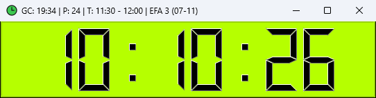

# EFA Trading Clock

A compact desktop clock for the Great Britain power market. It shows UK time and counts down to the next gate closure, with a background that fades from green to red as the deadline approaches.



## Run it

You need [uv](https://docs.astral.sh/uv/getting-started/installation/). It installs the right Python and dependencies for you.

```shell
git clone https://github.com/PatrickAvis/efa-trading-clock.git
cd efa-trading-clock
uv run efa-trading-clock
```

On Windows, you can also double-click `run-clock.bat`.

To install it as a standalone command:

```shell
uv tool install git+https://github.com/PatrickAvis/efa-trading-clock
efa-trading-clock
```

## What it shows

The large display is the current UK time. The title bar reads:

```text
GC: 12:34 | P: 23 | T: 11:00 - 11:30 | EFA 3 (07-11)
```

| Field | Meaning |
| --- | --- |
| `GC` | Time left until the next gate closure |
| `P` | Settlement period that gate closure applies to |
| `T` | Delivery window of that settlement period |
| `EFA` | EFA block in progress right now |

The background follows the `GC` countdown: green at 30 minutes, yellow at 15 minutes and red in the final minute.

## Market terms

- **Settlement period:** a half-hour delivery period, numbered from 1 at UK midnight. A normal day has 48, the day the clocks go forward has 46, and the day they go back has 50.
- **Gate closure:** the deadline one hour before a settlement period starts.
- **EFA block:** one of six four-hour blocks in the Electricity Forward Agreement day, which starts at 23:00 UK time.

| Block | 1 | 2 | 3 | 4 | 5 | 6 |
| --- | --- | --- | --- | --- | --- | --- |
| UK time | 23-03 | 03-07 | 07-11 | 11-15 | 15-19 | 19-23 |

All times use UK time, whatever timezone your computer is set to.

## Development

```shell
uv sync
uv run pytest
uv run ruff check .
uv run ruff format --check .
```

## Disclaimer

This is an unofficial tool, not affiliated with Elexon, NESO or any market operator. Check critical deadlines against official sources.

## Licence

[MIT](LICENSE)
